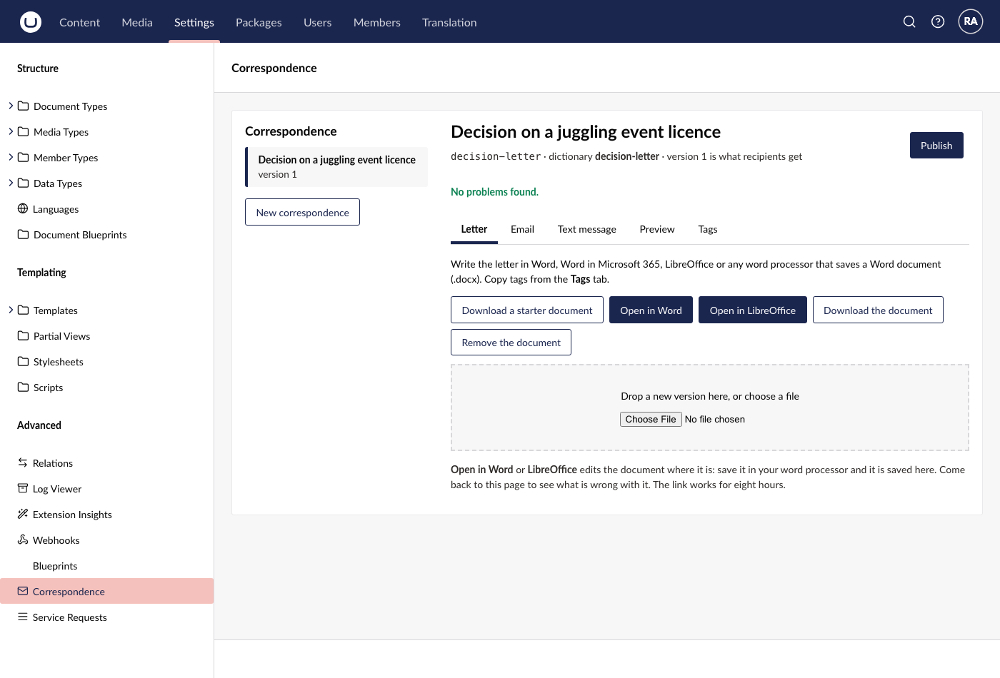

# Heliograph.Umbraco

[](https://github.com/jonnymuir/Heliograph.Umbraco/actions/workflows/ci.yml)
[](https://github.com/jonnymuir/Heliograph.Umbraco/blob/main/LICENSE)

**Letters, emails and text messages your content designers write themselves, kept in Umbraco
and sent by your site.**

Heliograph.Umbraco puts [Heliograph](https://github.com/jonnymuir/Heliograph) into the Umbraco
backoffice. An author writes the letter in Word or LibreOffice and the email and text message in
the backoffice, with a dictionary of the data they may use. Heliograph checks every part before
it can be published, shows each problem where it is, and previews it for made-up recipients. When
your site needs to send it, one call renders the published version for a real person: a Word
document (and a PDF), an email and a text message.

Heliograph renders; it never sends. Your site delivers what it produces through whichever mail,
print or SMS provider you use. It sits beside
[Wayfinder.Umbraco](https://github.com/jonnymuir/Wayfinder.Umbraco), so a service blueprint can
send a letter at any stage of a journey, but it does not need it.



> **Status: early.** Prereleases (`0.1.0-alpha.N`) are on nuget.org; expect changes between them.
> It targets Umbraco 17 (LTS) only.

## Contents

- [Try the reference site](#try-the-reference-site)
- [What you get](#what-you-get)
- [Use it in your own site](#use-it-in-your-own-site)
- [With Wayfinder](#with-wayfinder)
- [Requirements](#requirements)
- [Security](#security)
- [Not built yet](#not-built-yet)
- [How the repo is laid out](#how-the-repo-is-laid-out)
- [Building and testing](#building-and-testing)
- [Documentation](#documentation)

## Try the reference site

The repo holds a reference site: an Umbraco 17 site with Heliograph.Umbraco and Wayfinder.Umbraco
installed and something to try already in it. It never ships. It keeps everything in its own
SQLite database, created on first start.

### What you need

| | |
|---|---|
| .NET 10 SDK | Required |
| Node.js 20 or later | Required: builds the backoffice screen |
| Docker | Only for the Aspire option, which runs a local mailbox |
| LibreOffice | Optional: with it, letters can be edited from the backoffice. PDFs are made without it |

### Start it

| Option | How | Then open |
|---|---|---|
| **VS Code, with Aspire** (recommended) | Run and Debug → **C#: Aspire (Heliograph.Umbraco.ReferenceApp)** → press play | The Aspire dashboard opens, with links to the site, the Correspondence screen and **Mailpit**, where every email the site sends arrives |
| **VS Code, on its own** | Run and Debug → **C#: Heliograph.Umbraco.ReferenceApp (standalone)** | `https://localhost:44398`. Emails are saved as `.eml` files instead |
| **A terminal** | See below | `https://localhost:44398` |

```bash
cd src/Heliograph.Umbraco.Client && npm install && npm run build && cd ../..
dotnet run --project src/Heliograph.Umbraco.ReferenceApp
```

The first start takes a minute while Umbraco installs itself.

### Signing in

| Where | Who | How |
|---|---|---|
| Backoffice, `https://localhost:44398/umbraco` | Administrator | `admin@example.test` / `Heliograph123!` |
| Work queue, `https://localhost:44398/work-queue` | Casey Caseworker, the demo caseworker | One button, no password |
| The service pages | A member of the public | No sign-in |

These accounts are for this site on your own machine only. The backoffice signs in over HTTPS
only.

### What is there when it starts

- **The decision letter**, in **Settings → Correspondence**: a Word document, an email and a text
  message, with a dictionary of 15 fields and three sample recipients, published as version 1.
- **Apply for a juggling event licence**, a Wayfinder service: the public applies, a licensing
  officer decides, and Heliograph sends the decision letter.
- Wayfinder's starter kit: a home page, a work queue, and a second sample service.

### A five-minute tour

1. **Apply.** On the home page, open **Apply for a juggling event licence** and send an
   application with a made-up name and email address.
2. **Decide.** Open **Work queue**, sign in as the caseworker, pick up the application, press
   **Review**, and approve it (with a licence number, fee and date) or refuse it (with a reason
   and a review date). Press **Send the decision letter**.
3. **See what was sent.** The page says **Decision letter sent** and which version was used. The
   email, with the letter attached as a PDF, is in Mailpit (or `umbraco/Data/Mail`). The Word
   letter and the text message are in `umbraco/Data/Outbox/<request>`.
4. **See it refuse to send something wrong.** Refuse an application without a reason. Nothing is
   sent, and the caseworker is told exactly which values were missing.
5. **Change the letter.** Sign in to the backoffice and open **Settings → Correspondence**. Edit
   the text message, preview it with a sample recipient, and press **Publish**. The next
   application gets version 2.
6. **Edit the Word document in place.** Press **Open in LibreOffice** (or **Open in Word** on the
   desktop), change the letter, save, and come back to the backoffice to see whether it still
   checks out.

### Starting again

Stop the site and delete `src/Heliograph.Umbraco.ReferenceApp/umbraco/Data`. The next start
installs a fresh site with everything seeded again.

The [reference site guide](https://github.com/jonnymuir/Heliograph.Umbraco/blob/main/docs/skills/reference-site/SKILL.md)
goes further, and explains how the site joins Heliograph to Wayfinder.

## What you get

All of this comes from installing the package. A site adds nothing to its `Program.cs`.

| | |
|---|---|
| **Settings → Correspondence** | The Heliograph workbench, beside Wayfinder's Blueprints. Write the email and the text message with the dictionary's tags a click away. Bring the document in by dropping a `.docx`, start from a generated starter document, download it back with a Word comment at each problem, or open it in Word or LibreOffice and save straight back. Preview every part with a sample recipient, and publish. |
| **Checked before it is published** | Every part is compiled against its dictionary. A misspelt tag, a condition left open or a table that would break is reported with where it is and what to do. Nothing with an error can be published. |
| **Numbered versions** | Authors work on a draft. Publishing makes a version that never changes, and every render says which version it used, so you can record what each person was sent. |
| **Dictionaries kept in the backoffice** | Add and change the fields a correspondence may use, and the made-up recipients previews use. Saving says which letters a change breaks. A new dictionary can start from a Wayfinder blueprint's fields. |
| **Stored in the Umbraco database** | Drafts, versions, dictionaries and sample recipients, in the package's own tables. Two people saving at once cannot overwrite each other. |
| **An API for your code and the workbench** | `/heliograph/api`, closed to anyone who is not a backoffice user in an allowed group. |

## Use it in your own site

Add the package to an Umbraco 17 site. Its composer wires everything, so nothing goes in
`Program.cs`:

```bash
dotnet add package Heliograph.Umbraco --prerelease
```

To work on the package itself, build the backoffice screen before `dotnet build`:

```bash
cd src/Heliograph.Umbraco.Client && npm install && npm run build
```

### Who can work on correspondence

Members of the backoffice's **Administrators** group can, by default. Add the groups your
content designers are in:

```json
{
  "Heliograph": {
    "AdminGroupAliases": [ "admin", "contentDesigners" ]
  }
}
```

The groups also need the **Settings** section, which is where Correspondence sits.

### Adding a dictionary

A dictionary is the list of fields a correspondence may use. Authors keep dictionaries under
**Settings → Correspondence → Dictionaries**: add and change fields, keep the made-up sample
recipients previews use, and create a new one. Saving says which correspondence use the dictionary
and what each draft now gets wrong; published versions keep the dictionary they were published
with. The same is offered over the API and to an agent.

**New dictionary** can start from a ready-made one your site offers, by registering an
`IDictionaryStartingPoints`. The reference site offers one for each Wayfinder service blueprint,
with a field for everything it collects or calculates (`BlueprintStartingPoints.cs`).

Your site can also put dictionaries in from code, say from files it ships with:

```csharp
var dictionaries = services.GetRequiredService<UmbracoDictionarySource>();
await dictionaries.SaveAsync("licensing", File.ReadAllText("licensing.json"));
await dictionaries.SaveSampleAsync("licensing", "approved", File.ReadAllText("approved.json"));
```

The dictionary format is in Heliograph's guide,
[Using Heliograph](https://github.com/jonnymuir/Heliograph/blob/main/docs/skills/using-heliograph/SKILL.md#the-dictionary).

### Sending a correspondence

Render the published version for one person, and deliver each part your own way:

```csharp
var library = services.GetRequiredService<CorrespondenceLibrary>();
var render = await library.RenderAsync("decision-letter", recipientData, new RenderSettings(CultureInfo.GetCultureInfo("en-GB")));

if (render.Rendered is { } parts)
{
    // parts.Docx, parts.Email (subject, HTML, text), parts.Sms (text, encoding, message count)
    // render.Version is the version this person was sent: keep it with your record of what was sent.
}
else
{
    // render.Diagnostics says what was missing or wrong in this person's data. Nothing was rendered.
}
```

For a PDF, register Heliograph's own converter (`Heliograph.Pdf`) as the `IPdfConverter` and pass
the Word document to it. It needs nothing installed, so it runs anywhere .NET runs, an Azure App
Service included. Registered, it also checks every template as it is saved and published, and
refuses with the place and a fix what it cannot lay out yet. For a template that needs more,
register `LibreOfficePdfConverter` from `Heliograph.Pdf.LibreOffice` instead, with LibreOffice
installed on the server.

## With Wayfinder

The two packages do not refer to each other. The reference site joins them in about a hundred
lines you can copy: a Wayfinder support system, `heliograph`, with one capability,
`send-correspondence`. A blueprint stage names the correspondence and the field holding the
recipient's email address; the request's fields are the data; the stage moves on as `sent` or
`failed`. It needs Wayfinder 0.28 or later. The
[reference site guide](https://github.com/jonnymuir/Heliograph.Umbraco/blob/main/docs/skills/reference-site/SKILL.md#how-the-two-packages-are-joined)
explains each piece.

## Requirements

| | |
|---|---|
| Umbraco | 17 (LTS). The package will not install on 18: a new Umbraco major is a deliberate move, not an automatic one |
| .NET | 10 |
| Heliograph | 0.1.0-alpha.10, from nuget.org |
| Wayfinder.Umbraco | Optional. 6.4 or later with Wayfinder 0.28, to send correspondence from a blueprint |
| LibreOffice | Optional, on the server: opening documents from the backoffice, and PDFs if a site prefers it to Heliograph's own converter |

## Security

- **Correspondence holds personal data.** Never log rendered output or recipients' data.
  Diagnostics quote the template, never the data.
- **The API and the workbench** need a backoffice user in one of `Heliograph:AdminGroupAliases`.
- **Opening a document in Word or LibreOffice** uses a link that works without signing in,
  because a word processor cannot send your sign-in. Each link opens one draft document, expires
  after eight hours, and is signed with your site's Data Protection keys. Treat it like a
  password. With more than one server, share the Data Protection key ring.
- **Uploaded documents are untrusted.** Macros, embedded objects, links to outside content and
  oversized files are refused before anything reads them.

## Not built yet

- A listing on the Umbraco Marketplace. The package carries the `umbraco-marketplace` tag, which
  the Marketplace reads from nuget.org; the listing's own details come with the first stable
  release.
- An MCP endpoint in the backoffice, so an AI agent can work on correspondence by signing in as a
  backoffice user. Heliograph has the MCP server; the sign-in will be shared with Wayfinder.Umbraco.
- Carrying correspondence between environments with uSync.
- A check, before anything is sent, that a blueprint supplies every field a correspondence needs.
  Today a missing value is reported when the stage runs.

## How the repo is laid out

| | |
|---|---|
| `src/Heliograph.Umbraco` | The package |
| `src/Heliograph.Umbraco.Client` | The backoffice screen (TypeScript, Lit, Vite), built into the package |
| `src/Heliograph.Umbraco.ReferenceApp` | The reference site. Never ships |
| `src/Heliograph.Umbraco.AppHost` | Starts the reference site and Mailpit under .NET Aspire |
| `tests/Heliograph.Umbraco.Tests` | Fast tests, no site started |
| `tests/Heliograph.Umbraco.IntegrationTests` | Tests that start the reference site |

## Building and testing

```bash
cd src/Heliograph.Umbraco.Client && npm ci && npm run build && cd ../..
dotnet build Heliograph.Umbraco.slnx
dotnet test Heliograph.Umbraco.slnx
```

Every change reaches `main` through a pull request with CI, security scans and code-health checks.
[CLAUDE.md](https://github.com/jonnymuir/Heliograph.Umbraco/blob/main/CLAUDE.md) is the guide for
anyone, person or agent, working on the repo.

## Documentation

| | |
|---|---|
| [Reference site guide](https://github.com/jonnymuir/Heliograph.Umbraco/blob/main/docs/skills/reference-site/SKILL.md) | Everything the reference site does, and how Heliograph and Wayfinder are joined |
| [Writing a template](https://github.com/jonnymuir/Heliograph/blob/main/docs/skills/writing-a-template/SKILL.md) | For authors: tags, conditions, lists, the email and text message parts |
| [Using Heliograph](https://github.com/jonnymuir/Heliograph/blob/main/docs/skills/using-heliograph/SKILL.md) | For developers: dictionaries, rendering, PDF, what the library guarantees |
| [Diagnostics](https://github.com/jonnymuir/Heliograph/blob/main/docs/skills/diagnostics/SKILL.md) | Every problem Heliograph reports, by code |
| [Architecture](https://github.com/jonnymuir/Heliograph/blob/main/docs/architecture.md) and [brief](https://github.com/jonnymuir/Heliograph/blob/main/docs/brief.md) | The design, and the decisions behind it |

## Licence

[MIT](https://github.com/jonnymuir/Heliograph.Umbraco/blob/main/LICENSE)
